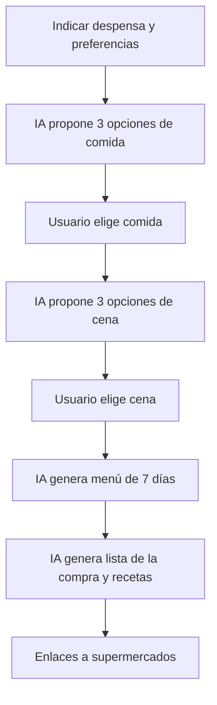

# 🍽️ MealToUs

> **Come sano ahorrando** — Planificación inteligente de menús con IA

[](https://python.org)
[](https://fastapi.tiangolo.com)
[](https://react.dev)
[](https://typescriptlang.org)
[](LICENSE)

---

## 📋 Tabla de Contenidos

- [¿Qué es MealToUs?](#qué-es-mealtous)
- [Características](#características)
- [Flujo de Uso](#flujo-de-uso)
- [Tecnologías](#tecnologías)
- [Estructura del Proyecto](#estructura-del-proyecto)
- [Puesta en Marcha](#puesta-en-marcha)
- [API Endpoints](#api-endpoints)
- [Tests](#tests)
- [Agentes de Desarrollo](#agentes-de-desarrollo)
- [Aviso Legal](#aviso-legal)

---

## 🎯 ¿Qué es MealToUs?

MealToUs es una aplicación web que **optimiza los alimentos que tienes en tu nevera y despensa**, planificando menús personalizados según tus preferencias y restricciones alimentarias.

### ¿Cómo funciona?

1. **Indicas qué tienes** en la nevera/despensa
2. **Configuras tus preferencias**: nº de personas, alergias, intolerancias, alimentos que no te gustan
3. **La IA propone 3 opciones** de comida (Healthy / Normal / Deportista) y 3 de cena
4. **Eliges una opción** de comida y una de cena
5. **Se genera un menú de 7 días** con kcal diarias ≈ comida + cena elegidas
6. **Se genera la lista de la compra** (solo lo que falta) y las recetas
7. **(Opcional) Enlaces a supermercados** para comprar online

---

## ✨ Características

| Característica | Descripción |
|----------------|-------------|
| 🥗 **3 tipos de dieta** | Healthy, Normal, Deportista |
| 🛡️ **Validación de alergias** | Red de seguridad determinista (25+ familias de alérgenos) |
| 📅 **Menú de 7 días** | Planificación semanal con control de kcal (±10%) |
| 🛒 **Lista de la compra** | Solo lo que falta, escalado al nº de personas |
| 📖 **Recetas incluidas** | Receta de cada plato del menú |
| 🏪 **Enlaces a supermercados** | Mercadona, Carrefour, Hipercor |
| 🧊 **Gestión de despensa** | Añade, lista y elimina alimentos |
| 👤 **Preferencias personalizadas** | Personas, alergias, intolerancias, dislikes |
| 🔐 **Autenticación** | Registro, login, forgot password, reset password |
| 🤖 **IA inteligente** | LLM con capa de abstracción (Anthropic/OpenAI) |

---

## 🔄 Flujo de Uso



---

## 🛠️ Tecnologías

### Backend
- **Python 3.11+** con FastAPI
- **Pydantic v2** para validación de datos
- **SQLAlchemy 2.0** para ORM (SQLite en desarrollo)
- **LLM por API** (Anthropic por defecto, OpenAI opcional)
- **JWT** para autenticación

### Frontend
- **React 18** + **TypeScript**
- **Vite** para bundling y dev server
- **React Router** para navegación

### Tests
- **pytest** con `FakeLLM` (sin gastar tokens)
- **TestClient** para endpoints FastAPI

---

## 📁 Estructura del Proyecto

```
MealToUs/
├── README.md
├── AGENTE.md               # Contexto y reglas del equipo de agentes
├── .agents/                # 5 agentes de desarrollo
│   ├── backend-python.md
│   ├── db-endpoints.md
│   ├── ia-agente.md
│   ├── preferencias-despensa.md
│   └── supermercados.md
├── .env.example            # Claves y configuración (copiar a .env)
├── docs/                   # Arquitectura, flujo de la IA y equipo de agentes
├── backend/
│   ├── requirements.txt
│   ├── app/
│   │   ├── main.py         # Arranque FastAPI
│   │   ├── core/           # Configuración
│   │   ├── db/             # Conexión a base de datos
│   │   ├── models/         # Tablas SQLAlchemy
│   │   ├── schemas/        # Contratos Pydantic
│   │   ├── api/            # Endpoints: auth, pantry, menus, shopping
│   │   ├── ai/             # Agente: llm_client, prompts, agent, validators
│   │   ├── integrations/   # Supermercados: Mercadona, Carrefour, Hipercor
│   │   └── services/       # Lógica de negocio sin LLM
│   └── tests/
└── frontend/
    └── src/
        ├── api/            # Cliente HTTP
        ├── types/          # Tipos TypeScript
        ├── pages/          # Pantry, Preferences, LunchOptions, DinnerOptions,
        │                   # WeeklyPlan, ShoppingList, Chat
        └── components/
```

---

## 🚀 Puesta en Marcha

### 1. Configurar variables de entorno

```bash
cp .env.example .env
# Edita .env y añade tu ANTHROPIC_API_KEY o OPENAI_API_KEY
```

### 2. Backend

```bash
cd backend
python -m venv .venv && source .venv/bin/activate
pip install -r requirements.txt
uvicorn app.main:app --reload   # http://localhost:8000/docs
```

### 3. Tests

```bash
cd backend
pytest                          # 17 tests pasando
```

### 4. Frontend (otra terminal)

```bash
cd frontend
npm install
npm run dev                     # http://localhost:5173
```

---

## 📡 API Endpoints

### Autenticación
| Método | Ruta | Descripción |
|--------|------|-------------|
| `POST` | `/api/auth/register` | Registrar nuevo usuario |
| `POST` | `/api/auth/login` | Iniciar sesión (JWT) |
| `POST` | `/api/auth/forgot-password` | Solicitar restablecimiento |
| `POST` | `/api/auth/reset-password` | Restablecer contraseña |
| `GET` | `/api/auth/me` | Usuario actual |
| `POST` | `/api/auth/logout` | Cerrar sesión |

### Despensa
| Método | Ruta | Descripción |
|--------|------|-------------|
| `GET` | `/api/pantry/` | Listar alimentos |
| `POST` | `/api/pantry/` | Añadir alimento |
| `DELETE` | `/api/pantry/{id}` | Eliminar alimento |

### Menús (IA)
| Método | Ruta | Descripción |
|--------|------|-------------|
| `POST` | `/api/menus/lunch-options` | 3 opciones de comida |
| `POST` | `/api/menus/dinner-options` | 3 opciones de cena |
| `POST` | `/api/menus/weekly-plan` | Menú de 7 días |
| `POST` | `/api/menus/shopping` | Lista de compra y recetas |
| `POST` | `/api/menus/chat` | Chat con asistente |

### Supermercados
| Método | Ruta | Descripción |
|--------|------|-------------|
| `POST` | `/api/shopping/supermarket-links` | Enlaces a carritos |

---

## 🧪 Tests

```bash
cd backend
pytest                          # 17 tests pasando
pytest tests/test_agent.py      # 6 tests del agente IA
pytest tests/test_supermarkets.py # 5 tests de supermercados
pytest tests/test_endpoints.py  # 6 tests de endpoints
```

---

## 🤖 Agentes de Desarrollo

El proyecto utiliza **5 agentes especializados** para desarrollo en paralelo:

| Agente | Territorio | Responsabilidad |
|--------|------------|-----------------|
| `db-endpoints` | `models/`, `schemas/`, `api/`, `db/` | Tablas, schemas, endpoints |
| `backend-python` | `ai/`, `services/`, `integrations/`, `core/` | Lógica IA, prompts, validadores |
| `ia-agente` | `ai/agent.py`, `prompts.py`, `validators.py` | Flujo completo de IA |
| `supermercados` | `integrations/supermarkets/` | Mercadona, Carrefour, Hipercor |
| `preferencias-despensa` | `models/pantry.py`, `schemas/pantry.py` | Gestión de despensa |

---

## ⚠️ Aviso Legal

Las calorías y recomendaciones son **estimaciones generadas por IA** y no sustituyen el consejo de un dietista o médico. Revisa siempre las alergias en las etiquetas de los productos.

---

## 📄 Licencia

MIT License - Ver [LICENSE](LICENSE) para más detalles.

---

<p align="center">
  <strong>🍽️ MealToUs</strong> — Come sano ahorrando
</p>